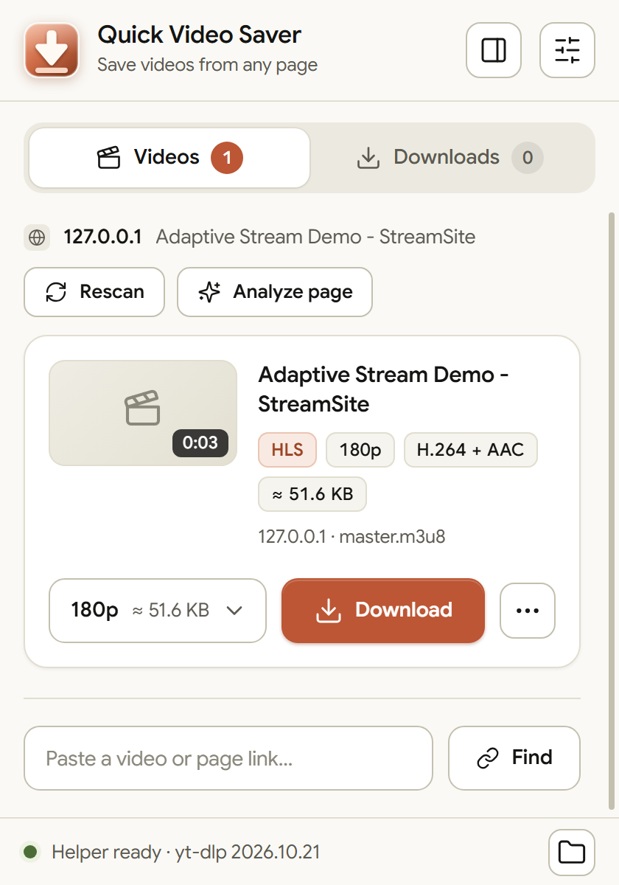
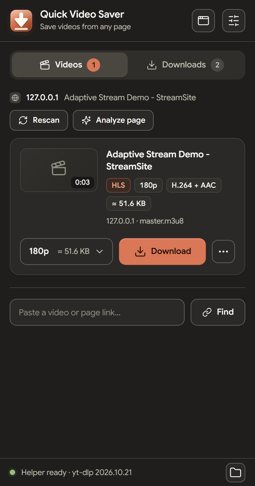
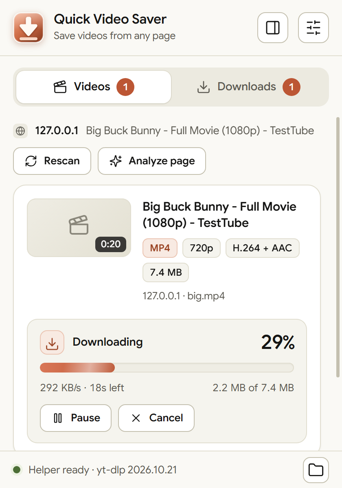
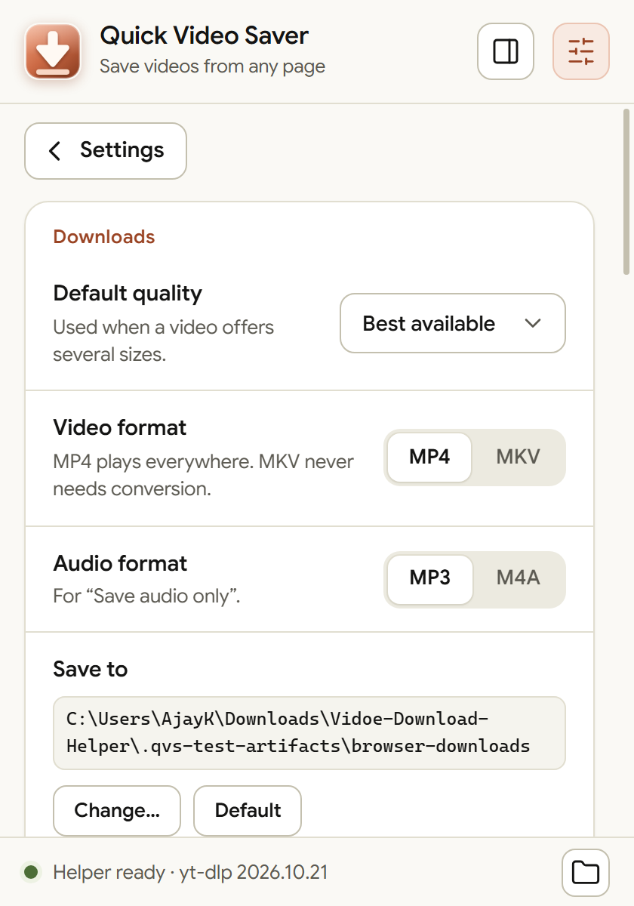
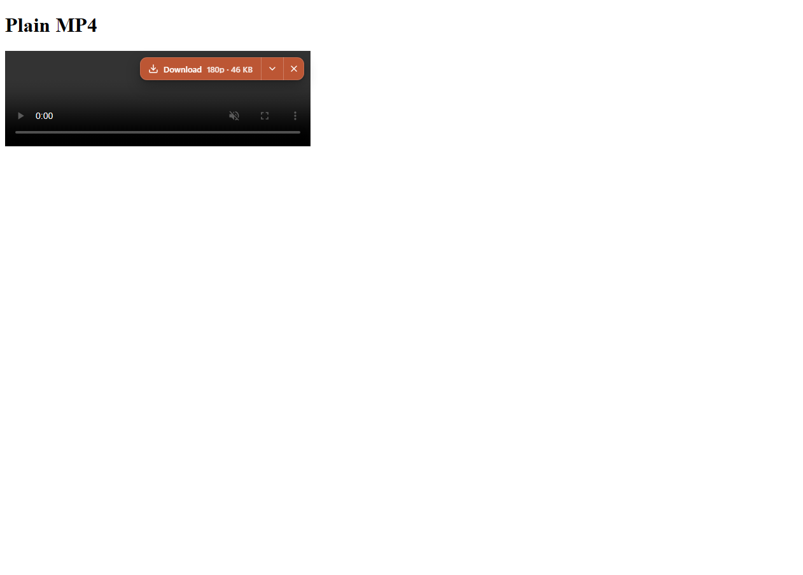
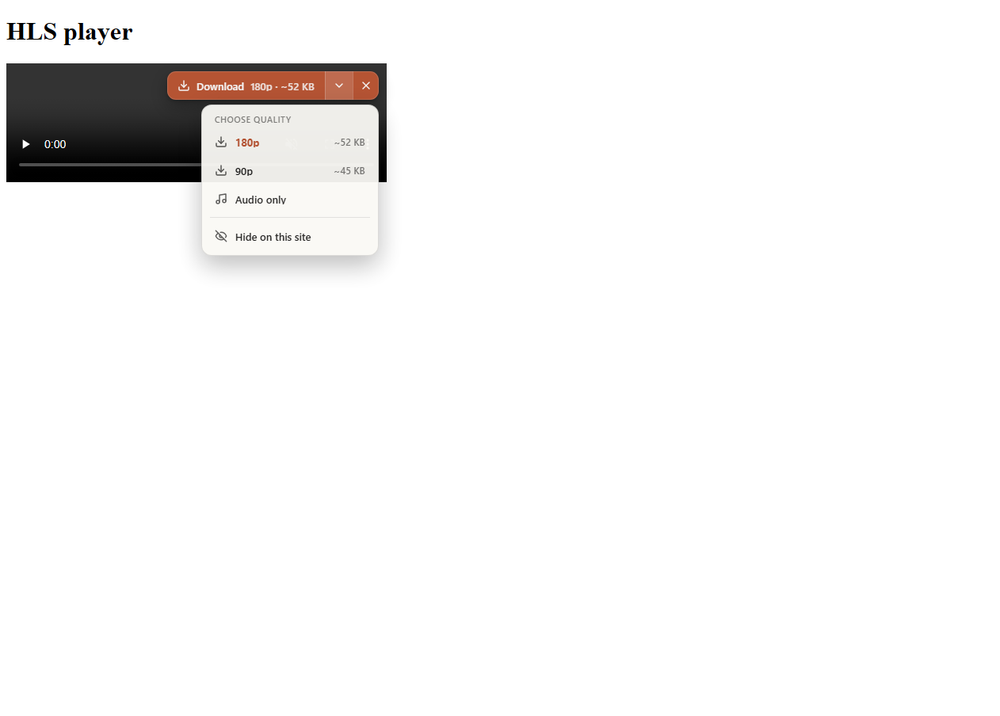

# Quick Video Saver — Free Video Downloader Extension for Chrome, Brave & Edge (HLS, M3U8, DASH, MP4)

[](LICENSE)
-0078D4)


**Quick Video Saver** is a free, open-source browser extension that finds the video on the page you are watching and saves it to your PC as a normal `.mp4` file. It handles plain video files, **HLS (`.m3u8`) and DASH (`.mpd`) streams**, videos hidden inside page scripts, and links from 1000+ sites. No account, no quota, no ads, no watermark, no cloud server. Everything runs on your own computer.

It works in **Google Chrome, Brave, Microsoft Edge** and other Chromium browsers (Vivaldi, Opera) on **Windows 10/11 (64-bit)**.



---

## Table of contents

- [What does it do?](#what-does-it-do)
- [Features](#features)
- [Screenshots](#screenshots)
- [Install in 4 steps](#install-in-4-steps)
- [How to use](#how-to-use)
- [Why it is better than most video downloader extensions](#why-it-is-better-than-most-video-downloader-extensions)
- [How it works](#how-it-works)
- [Permissions explained](#permissions-explained)
- [Privacy](#privacy)
- [Limits (honest list)](#limits-honest-list)
- [Troubleshooting](#troubleshooting)
- [FAQ](#faq)
- [Hindi / Hinglish guide](#hindi--hinglish-guide)
- [Update and uninstall](#update-and-uninstall)
- [For developers](#for-developers)
- [Credits and licenses](#credits-and-licenses)
- [Responsible use](#responsible-use)

---

## What does it do?

Open any page that plays a video, press play, click the extension icon (or the **Download** button that appears on the video), pick a quality and save. That is the whole idea.

Behind that one click the extension does the hard parts for you:

1. **Detects** every video on the page: direct files (`.mp4`, `.webm`, `.mkv`), HLS and DASH streams, blob videos played through `hls.js` / `dash.js`, and streams that a site hides inside `fetch`, `XHR` or Media Source Extensions calls.
2. **Shows a clean card** for each video with the real page title, format, resolution, codec, duration and file size, so you know what you are saving before you save it.
3. **Downloads and merges** the stream (video + audio, all segments, encrypted AES-128 HLS included) into a single file using a small local helper built on [yt-dlp](https://github.com/yt-dlp/yt-dlp) and [FFmpeg](https://ffmpeg.org/).
4. **Keeps going when sites make it hard**: it forwards your login cookies, `Referer`, `User-Agent` and custom headers for that one site, retries with a different method when a download fails, and re-reads the page when a link expires.

## Features

| | |
|---|---|
| **One-click download button on the video** | Hover a video and a *Download* pill appears in its top-right corner (like IDM). One click saves the default quality; the arrow lets you choose another quality or *Audio only*. Can be switched off or hidden per site. |
| **Popup *and* side panel** | Use the compact popup (`Alt+Shift+V`) or keep the extension open in the browser side panel (`Alt+Shift+S`) while you browse. |
| **HLS / M3U8 and DASH / MPD** | Picks the quality from master playlists, merges separate audio and video, handles AES-128 encrypted and disguised segments. |
| **Hidden stream detection** | A page-level hook catches playlists that never appear as normal links. |
| **Paste any link** | YouTube-type pages, Vimeo, X/Twitter, Reddit, TED, archive.org and 1000+ more sites through yt-dlp. |
| **Analyze page** | When nothing is found, the helper studies the page and looks for streams the browser did not show. |
| **Audio only** | Save the sound track as MP3/M4A. |
| **Pause, resume, cancel** | Unfinished files stay in a hidden `.partial` folder and continue where they stopped. Stopping a **live stream** saves what was recorded so far. |
| **Smart file names** | `Movie Name [1080p].mp4`: page title without the site name, plus resolution. Duplicates become `(2)`, `(3)`. |
| **Safe by default** | Warns before the disk is full, rejects unsafe requests, deletes temporary cookie files after each download. |
| **Self-updating downloader** | yt-dlp refreshes itself every 3 days (or manually from Settings) because sites change constantly. |
| **Right-click menu** | *Download this video*, *Download this link*, *Save the video from this page*. |
| **Light and dark theme** | Offline Google Sans font bundled, so the interface looks the same without internet. |

## Screenshots

| Popup | Dark side panel |
|---|---|
|  |  |

| Live progress with pause and cancel | Settings |
|---|---|
|  |  |

| Download button on the video | Quality menu |
|---|---|
|  |  |

## Install in 4 steps

> Needs **Windows 10/11 64-bit** and Chrome 116+, Brave or Edge. No administrator rights needed.

### 1. Download

Go to the **[Releases](../../releases)** page and download **`Quick-Video-Saver-Lite.zip`** (small, fetches the tools during setup) or **`Quick-Video-Saver-Windows.zip`** (full, works offline). Alternatively press **Code → Download ZIP** on this page.

### 2. Extract and run setup once

Right-click the ZIP → **Extract All** into a folder you will keep (for example `D:\Tools\Quick-Video-Saver`; do not delete it later, the browser reads the extension from there). Double-click **`SETUP-WINDOWS.cmd`**.

Setup installs the local helper (portable Python, yt-dlp, FFmpeg, Deno), checks every download against a SHA-256 hash from `helper/sources.json`, and registers the helper for Chrome, Brave, Edge and Chromium for your Windows user only. It does not install anything globally, change `PATH` or run a background service.

### 3. Load the extension

Open `chrome://extensions` (Brave: `brave://extensions`, Edge: `edge://extensions`), turn on **Developer mode**, click **Load unpacked** and choose the **`extension`** folder.

### 4. Restart the browser and pin the icon

Restart the browser, pin **Quick Video Saver** to the toolbar and you are ready. The popup footer shows **"Helper ready"** with the yt-dlp version when everything works.

## How to use

1. Open a page with a video and press play.
2. Click the toolbar icon (`Alt+Shift+V`) **or** click the **Download** pill on top of the video.
3. Choose the quality in the card (size is shown) and press **Download**.
4. Watch progress in the same card or on the **Downloads** tab. Files land in `Downloads\Quick Video Saver` (change it in Settings).

Other things you can do:

- **Nothing detected?** Press **Analyze page**.
- **Have a link?** Paste it into the *Paste a video or page link* box and press **Find**.
- **Want just the sound?** Open the card's three-dots menu → *Audio only*.
- **Prefer a sidebar?** Press `Alt+Shift+S` or the sidebar icon in the popup.

## Why it is better than most video downloader extensions

Most downloader extensions give you a long list of raw URLs, or only work for plain `.mp4` files, or push you towards a paid tier. Quick Video Saver is built around the cases where those fail. The comparison below is about the *typical* store video downloader, not one specific product.

| | Typical video downloader extension | **Quick Video Saver** |
|---|---|---|
| Price / limits | Often free tier with limits, ads or a paid upgrade | **Free, no quota, no account, no watermark** |
| Streaming video (HLS/DASH) | Often shows `.ts` segments or only the playlist file | **Merges the whole stream into one MP4**, picks the quality for you |
| Hidden / blob videos | Often misses them | **Page hook catches streams inside fetch / XHR / MSE** |
| What you see before saving | URL list | **Title, format, resolution, codec, duration, size** |
| Sites that need login or Referer | Download fails or returns an error page | **Sends cookies, Referer, User-Agent, custom headers** for that site |
| When a download fails | Stops | **Retries with other methods** (browser identity, page extractor, FFmpeg) |
| Pause / resume | Rare | **Yes**, plus "stop live stream and keep the recording" |
| Link expires | Dead download | **Re-reads the page** for a fresh link |
| One-click button on the video | Sometimes | **Yes**, with quality menu and per-site hide |
| Side panel | Rare | **Yes** |
| Keeps working over time | Depends on the author pushing updates | **yt-dlp self-updates every 3 days** |
| Where your data goes | Often a vendor server | **Nowhere.** Everything runs on your PC |
| Source code | Often closed | **Open, MIT licensed** |
| Tested | Rarely documented | **108 automated tests** plus real-browser end-to-end runs ([details](docs/VALIDATION.txt)) |

## How it works

```
Browser extension (Manifest V3)  <-- native messaging -->  Local helper (Python)
  - finds videos on the page                                  - yt-dlp: extraction and download
  - shows the card / button / side panel                      - FFmpeg: merge, convert
  - sends the download request                                - Deno: JavaScript runtime used by yt-dlp
                                                              - saves files to your Downloads folder
```

The extension cannot write large merged files or run yt-dlp by itself, so it talks to a tiny local helper (`helper/host.py`) through Chrome's official [Native Messaging](https://developer.chrome.com/docs/extensions/develop/concepts/native-messaging) channel. There is no local web server and no open port.

Repository layout:

```
extension/      the Chrome/Brave/Edge extension (load this folder)
helper/         native-messaging helper (host.py) and pinned tool versions (sources.json)
docs/           screenshots and validation report
setup.ps1       installs and registers the helper (run via SETUP-WINDOWS.cmd)
uninstall.ps1   removes the registration (run via UNINSTALL-HELPER.cmd)
```

## Permissions explained

The extension asks for broad permissions because a video can be on any website. Here is what each one is used for.

| Permission | Why |
|---|---|
| `http://*/*`, `https://*/*` | Find videos on any site you visit |
| `webRequest`, `webNavigation` | See which media/playlist requests a page makes |
| `scripting` | Insert the page hook and the on-video button |
| `downloads` | Hand direct files to the browser and reveal finished files |
| `nativeMessaging` | Talk to the local helper |
| `cookies` | Send your session to the helper **only for the site the video comes from** |
| `declarativeNetRequest` | Add the `Referer` / headers some sites require |
| `storage` | Save your settings |
| `sidePanel` | Side panel mode |
| `contextMenus`, `notifications` | Right-click menu and "download finished" notice |

You can read every line yourself, the extension is plain JavaScript with no build step and no minified code.

## Privacy

- **No analytics, no tracking, no accounts, no Quick Video Saver server.**
- Cookies are passed only to the local helper, only for the site that serves the video, and the temporary file is deleted after the download.
- Network requests that do happen: the page you are downloading from, and the helper's own tool downloads/updates from their official sources (python.org and GitHub releases of yt-dlp, FFmpeg-Builds and Deno).

## Limits (honest list)

- **DRM-protected video** (Netflix, Prime Video, Hotstar premium and similar) cannot be saved by this or any normal tool.
- Some sites with login walls, geo-blocks, bot checks or scripts that decrypt the stream themselves can still fail. Try **Settings → Update downloader** first.
- **Windows 10/11 64-bit only** for now (the setup script is PowerShell and the runtime is Windows binaries).
- Installed with **Load unpacked** (Developer mode), not from the Chrome Web Store.
- Windows 10 and non-ASCII Windows user names were not covered by the test machine. The full list of what was and was not verified is in [docs/VALIDATION.txt](docs/VALIDATION.txt).

## Troubleshooting

| Problem | Fix |
|---|---|
| Popup says the helper is missing | Run `SETUP-WINDOWS.cmd`, then restart the browser completely |
| "Unknown action" or odd behaviour after replacing files | Press the reload button of the extension in `chrome://extensions` |
| Download fails on a site that worked before | Settings → **Update downloader**, or run `UPDATE-TOOLS.cmd` |
| No video found | Press play first, then **Rescan** or **Analyze page** |
| Setup says the path is unsafe | Extract to a folder whose name has no `%` or `!` |
| Extension stopped after moving the folder | Move it back, or run setup again from the new place and Load unpacked again |

More help with screenshots: open `START-HERE.html`.

## FAQ

**How do I download an HLS / M3U8 video in Chrome?**
Install Quick Video Saver, open the page, press play, click the extension (or the on-video Download button), choose a quality and press Download. The helper downloads all segments and gives you one MP4.

**Can it download MPD / DASH streams?**
Yes. Separate video and audio tracks are merged with FFmpeg.

**Does it work in Brave and Edge?**
Yes. Setup registers the helper for Chrome, Brave, Edge and Chromium. Vivaldi and Opera read the Chrome registration.

**Is it really free? Any limit?**
Yes. No account, no quota, no paid tier, no ads.

**Is it safe?**
The source is here to read, tools are downloaded from official releases and checked against SHA-256 hashes, and nothing is sent to a Quick Video Saver server. It still needs broad browser permissions, explained above.

**Can it download Netflix or other DRM videos?**
No.

**Do I need Python, FFmpeg or yt-dlp installed?**
No. Setup brings its own portable copies and does not touch your system.

**Does it work on Mac or Linux?**
Not yet; the setup and runtime are Windows-only.

## Hindi / Hinglish guide

**Ye kya hai?** Quick Video Saver ek free Chrome / Brave / Edge extension hai jo kisi bhi website ka video (normal MP4, HLS/M3U8, DASH stream, YouTube jaise page link) detect karke aapke PC me save kar deta hai. Koi account, quota ya watermark nahi.

**Install kaise kare:**
1. **Releases** page se `Quick-Video-Saver-Lite.zip` (ya offline wala Full ZIP) download karein.
2. ZIP ko right-click karke **Extract All** karein, aise folder me jo aap delete nahi karenge. Phir **`SETUP-WINDOWS.cmd`** double-click karein (admin ki zarurat nahi).
3. Browser me `chrome://extensions` (Brave: `brave://extensions`) kholein → **Developer mode ON** → **Load unpacked** → extracted folder ka **`extension`** folder chunein.
4. Browser restart karein aur extension ko toolbar par pin karein.

**Use kaise kare:** video wala page kholein, play karein, video ke top-right me aaye **Download** button par click karein ya toolbar icon (`Alt+Shift+V`) dabayein, quality chunein aur Download dabayein. Video na mile to **Analyze page** dabayein. Video files `Downloads\Quick Video Saver` folder me milti hain.

**Dhyan rahe:** DRM wale videos (Netflix, Prime, Hotstar premium) save nahi ho sakte. Sirf wahi videos save karein jo aapke hain ya jinhe save karne ki permission hai.

## Update and uninstall

**Update:** copy the new files over the old folder, then press the reload button of the extension in `chrome://extensions`. No need to run setup again. To refresh only the downloader, use Settings → Update downloader or `UPDATE-TOOLS.cmd`.

**Uninstall:** remove the extension from the browser and run `UNINSTALL-HELPER.cmd`. Your downloaded videos are not touched.

## For developers

There is no build step: the extension is plain ES-module JavaScript.

```
git clone https://github.com/sajaym/quick-video-saver.git
cd quick-video-saver
SETUP-WINDOWS.cmd        # installs helper runtime and registers it
# then Load unpacked -> extension/
```

The extension ID is fixed by the `key` in `extension/manifest.json`, which is what lets the helper allow only this extension (`allowed_origins`). Pull requests and issues are welcome: please include the browser version, the page URL (if public) and the helper line from the popup footer.

## Credits and licenses

Quick Video Saver is released under the [MIT License](LICENSE). It is independent software and is **not affiliated with Video DownloadHelper**, YouTube or any website it can read.

It relies on excellent open-source projects: [yt-dlp](https://github.com/yt-dlp/yt-dlp) (Unlicense), [FFmpeg](https://ffmpeg.org/) (GPL build by [yt-dlp/FFmpeg-Builds](https://github.com/yt-dlp/FFmpeg-Builds)), [Deno](https://deno.com/) (MIT), [Python](https://www.python.org/) (PSF), [Lucide icons](https://lucide.dev) (ISC) and Google Sans (SIL OFL 1.1). Full details in [THIRD-PARTY-NOTICES.txt](THIRD-PARTY-NOTICES.txt).

## Responsible use

Use this tool only for videos you own, videos that are free to download, or content you have permission to save. Respect copyright and each website's terms. The authors do not support piracy and are not responsible for misuse.

---

*Keywords: video downloader, Chrome extension, Brave extension, Edge extension, HLS downloader, M3U8 downloader, DASH downloader, MPD, MP4 downloader, stream downloader, yt-dlp GUI, FFmpeg, save video from website, download embedded video, Manifest V3, native messaging, side panel.*
